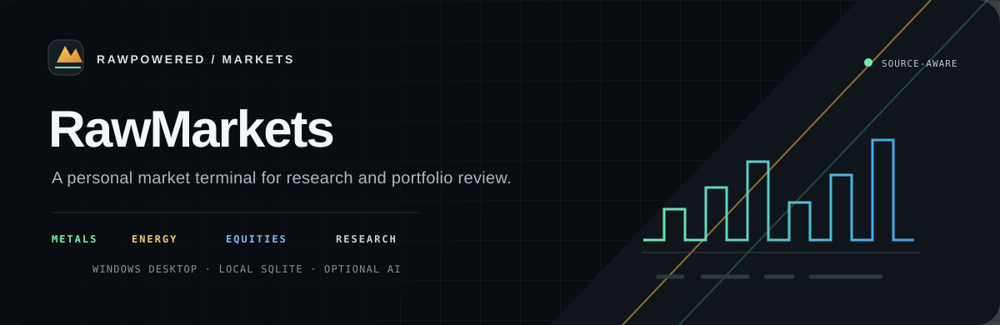
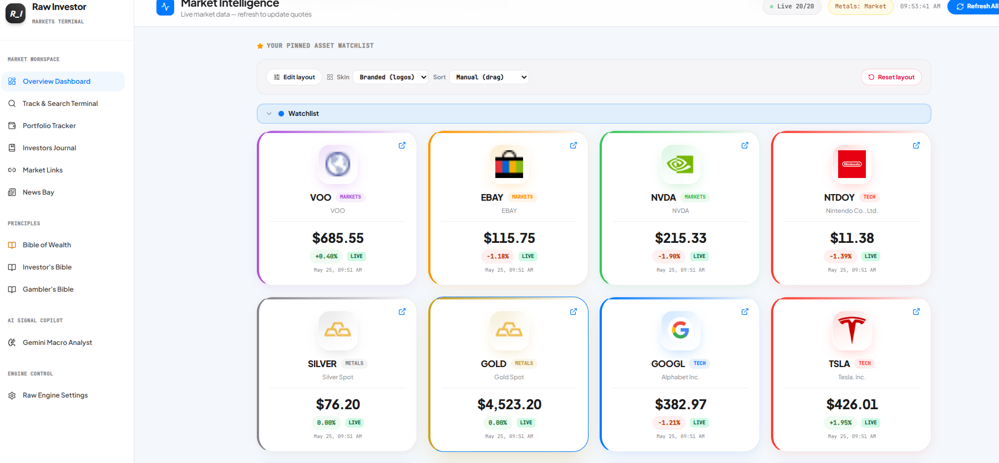
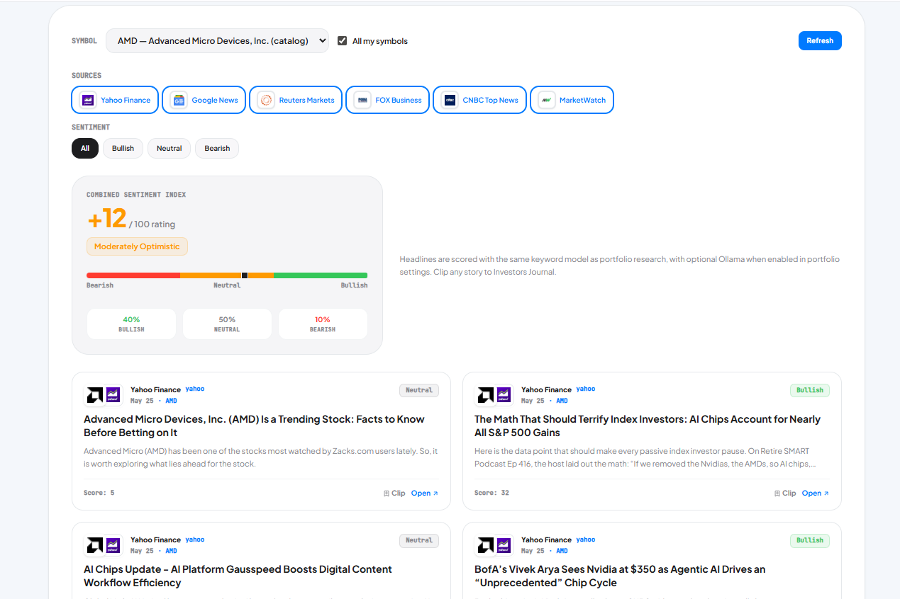
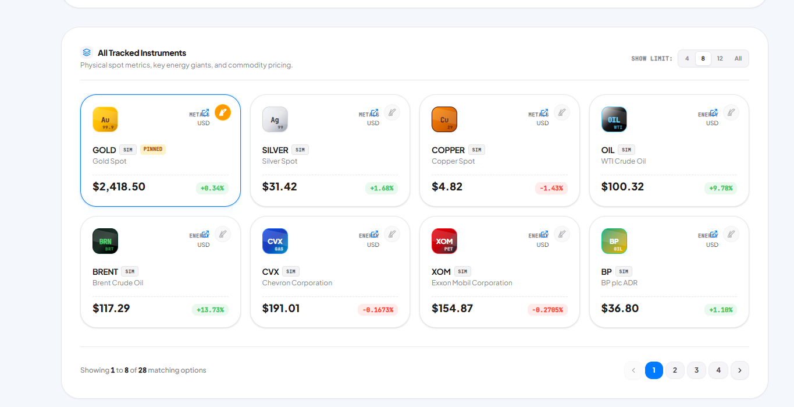
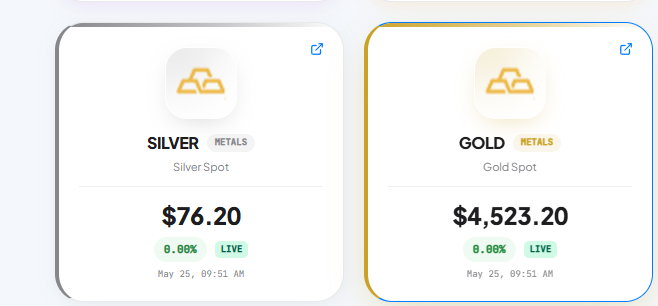

<div align="center">
  

  <br />

  **A desktop workspace for market context, portfolio review, and research.**

  [Product tour](#product-tour) · [Capabilities](#capabilities) · [Run locally](#run-locally) · [Architecture](docs/ARCHITECTURE.md) · [Data sources](docs/DATA-SOURCES-AND-LIMITS.md) · [Security](SECURITY.md)

  <br />

  
  
  
  
</div>

RawMarkets brings market quotes, precious metals, news context, and personal portfolio tools into one Windows desktop application. The interface keeps feed state visible so live, cached, simulated, and unavailable data are easier to distinguish.

This repository now includes the application source so reviewers can inspect how the product is built. Local databases, API credentials, environment maps, installers, and packaged releases are excluded. The application has no license grant; all rights are reserved unless the maintainer adds a license.

## Product tour

The captures below were recorded **May 22 to 25, 2026**. Their prices, timestamps, sentiment scores, and provider states are historical examples of the interface, not current market information.

<p align="center">
  
</p>

<p align="center"><sub>Overview dashboard · Watchlist cards · Feed status · Market workspace</sub></p>

<p align="center">
  
</p>

<p align="center"><sub>News Bay · Source selection · Sentiment lanes · Save stories to Investors Journal</sub></p>

<details>
  <summary>More interface captures</summary>

  <p align="center">
    
  </p>
  <p align="center"><sub>Searchable catalog · Category filters · Pinned instruments · Historical sample values</sub></p>

  <p align="center">
    
  </p>
</details>

## Capabilities

| Workspace | What it brings together |
| --- | --- |
| **Market terminal** | Searchable instruments, categories, pinned assets, quote cards, price history, and source status across equities, energy, and commodities. |
| **Precious metals** | Gold, silver, platinum, and palladium spot views, ounce and gram conversions, and an allocation planner. |
| **News Bay** | Watchlist-aware news lanes, source filters, headline sentiment, and links into the Investors Journal. |
| **Portfolio tracker** | Holdings and transaction records, allocation views, price history, statement import, and review signals. |
| **Research tools** | Portfolio research jobs, market context, personal journal entries, and structured notes for later review. |
| **AI signal copilot** | Ollama-based local chat and scoring when configured, with optional Gemini analysis and web-search services. Each provider has a different data boundary. |
| **Local data controls** | SQLite persistence, configurable feeds, API-key management, data export and import, and dashboard layout controls. |

## Run locally

**Requirements:** Windows, Node.js, and Python for optional research helpers. Ollama and provider API keys are optional.

```powershell
npm install
npm run prepare:runtime
npm run dev
```

Open `http://localhost:3000`. The API binds to loopback by default. Playwright Chromium is needed for the Kitco and Yahoo scraping path and can be installed with `npm run scrape:install`. Configure optional provider keys from the application settings or environment variables. See `.env.example` and [Security](SECURITY.md) before configuring external access.

To open the Electron shell, use `npm run launcher` after installing dependencies. Python research helpers use the packages in `python/requirements.txt`.

## How data moves

RawMarkets runs a local API and SQLite database alongside its desktop interface. Feed adapters gather source data, normalize it, and label results as live, cached, simulated, or unavailable. Optional services change the data boundary. Ollama can run on the same machine. Gemini and configured search or market-data providers are remote services.

Read [Architecture](docs/ARCHITECTURE.md), [Data sources and limits](docs/DATA-SOURCES-AND-LIMITS.md), and [Security](SECURITY.md) before enabling external integrations.

## Technology

`React` · `TypeScript` · `Vite` · `Electron` · `Express` · `SQLite` · `Playwright` · `Python` · `Ollama` · `Gemini`

## Code map

| Path | Review focus |
| --- | --- |
| [`src/`](src/) | React interface, API routes, data providers, local AI, and application services. |
| [`electron/`](electron/) | Desktop startup, process boundaries, and local server lifecycle. |
| [`migrations/`](migrations/) | SQLite schema evolution. |
| [`python/`](python/) | Optional portfolio research helpers. |
| [`scripts/`](scripts/) | Runtime setup, local packaging, and build support. |
| [`tests/`](tests/) | Existing unit and integration test coverage. |

The GitHub Actions workflow validates dependency installation, TypeScript types, and the production build on Windows. It does not package an installer.

## Scope and status

- RawMarkets is a personal research and portfolio-review application. It does not place trades or connect to a brokerage for order execution.
- Quote freshness and completeness depend on the selected provider, network, and source. Scraped websites can change without notice.
- Sentiment and portfolio signals are review aids. They are not verified predictions or financial advice.
- The source is published for inspection. No binary installer or user database is distributed here.
- No license is included. All rights are reserved unless a license is added by the maintainer.

For more work across automation, CRM, web, and market tools, visit [RawPowered](https://github.com/RawPowered).
