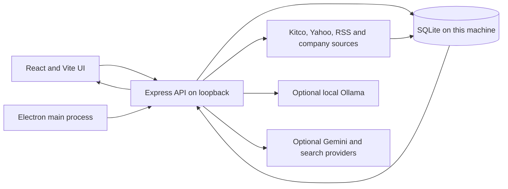

# Architecture

RawMarkets is a Windows desktop application with a web interface, a local Express API, and a local SQLite database. Electron starts the desktop shell and API process. The Vite and React interface communicates with the API over loopback by default.

## Application areas

- **Market workspace:** symbol search, pinned and hidden assets, quote history, and dashboard layouts.
- **News Bay:** feed aggregation, source preferences, symbol context, headline sentiment, and article storage.
- **Portfolio:** holdings, transactions, statement import, quote refresh, allocation views, and research jobs.
- **Investors Journal:** saved research, market links, article notes, and attached media.
- **AI Signal Copilot:** Ollama chat and headline scoring when a local model is configured. Separate Gemini analysis and SerpApi search can be enabled with provider keys.
- **Local services:** Express routes, source adapters, SQLite repositories, migrations, and optional Python research helpers.

## Local API surface

The renderer talks to a local API rather than to an application-owned cloud backend. Common route groups include:

| Route group | Purpose |
| --- | --- |
| `/api/health`, `/api/data-status` | Process and feed readiness. |
| `/api/market-data`, `/api/quote/*`, `/api/chart-history/*`, `/api/precious-metals` | Quotes, history, and metals feed. |
| `/api/news`, `/api/news-bay/*` | News feed and source preferences. |
| `/api/portfolio/*` | Holdings, transactions, imports, and research jobs. |
| `/api/journal/*` | Journal entries, article capture, and media. |
| `/api/local-ai/*` | Local model status and contextual chat. |
| `/api/admin/*`, `/api/engine/*` | API key metadata, engine settings, backups, and maintenance actions. |

Admin routes have separate access checks. The server binds to `127.0.0.1` by default. See [Security](../SECURITY.md) before changing the bind address or connecting a hosted frontend.

## Persistence and providers

SQLite is the system of record for the local installation. It stores app data, feed caches, journal records, portfolio information, settings, and provider keys saved in the app. A database export can therefore contain sensitive information.

Market and news adapters call external provider sites or APIs. Ollama is local when configured on the same computer. Gemini and SerpApi are remote services. A user's provider settings determine which of these services receives a request. The public showcase has no shared backend or public market-data API.

## Build and packaging

The source code is published in this repository for review. Local databases, environment maps, API credentials, and packaged installers are excluded. The project uses Vite for the interface, TypeScript and Express for the API, Electron for the desktop shell, SQLite for persistence, and Windows packaging scripts for installer artifacts.
